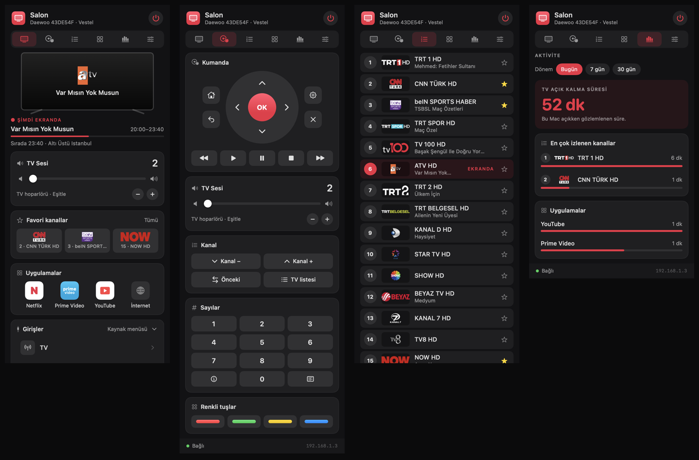
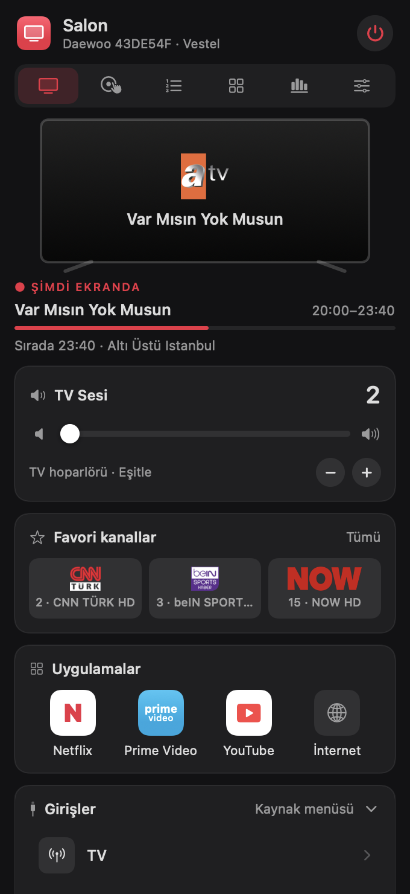
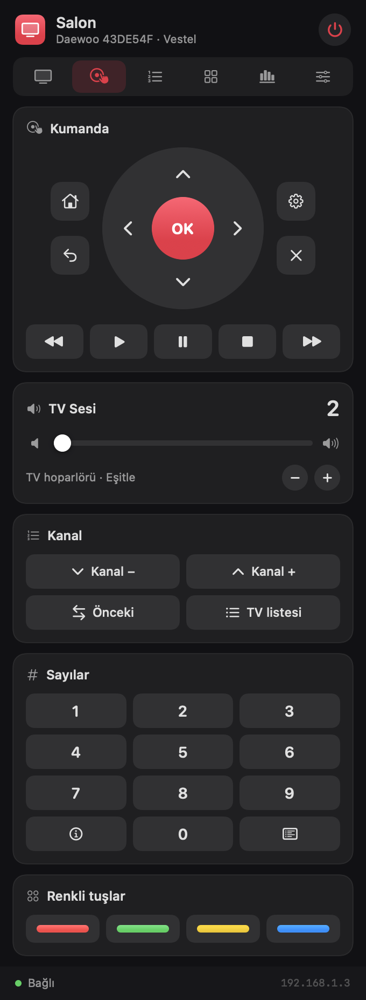
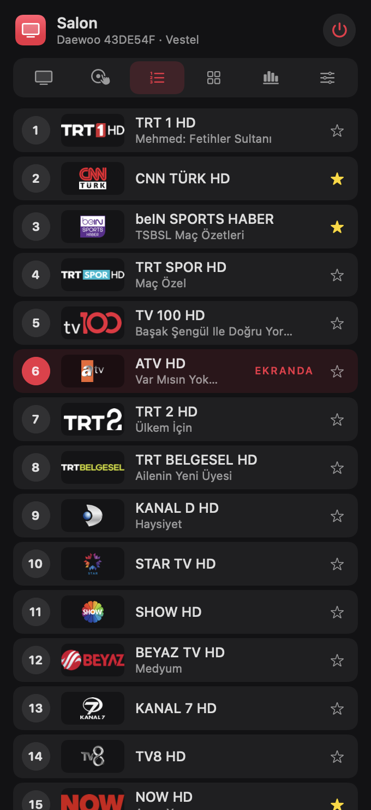
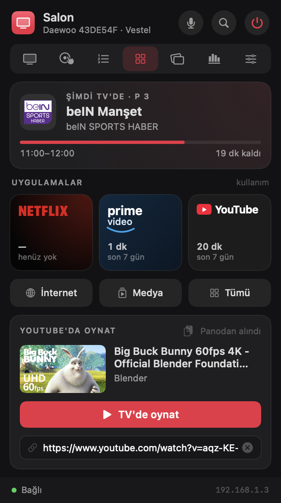
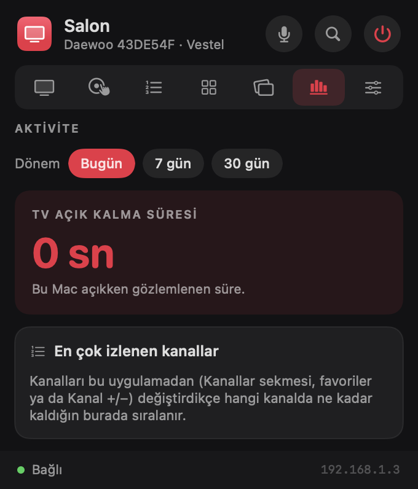

<div align="center">

# 📺 TV Kumanda

**Vestel tabanlı akıllı TV'ni Mac'in menü çubuğundan yönet.**

Kumanda, kanal listesi, uygulamalar, ses ve izleme istatistikleri; hepsi menü çubuğundaki simgeden açılan tek bir panelde.




</div>

---

## Neden?

Fiziksel kumanda kırılınca TV'yi telefondaki *TV Smart Centre* uygulamasıyla yönetmek zorunda kalmıştım. Bu proje, aynı kontrolü Mac'e taşıyor. Hiçbir buluta bağlanmıyor; Mac ile TV, yerel ağ üzerinden doğrudan konuşuyor.

Test edilen cihaz: **Daewoo 43DE54F** (anakart: Vestel **17MB181TC**). Vestel'in SmartCenter altyapısını kullanan diğer TV'lerde de (Vestel, Toshiba, Hitachi, Telefunken, JVC, Finlux…) çalışması beklenir.

## Özellikler

| | |
|---|---|
| 🖥 **Ekranda** | TV'de o an ne açık: kanal logosu, **yayındaki program**, ilerlemesi ve sıradaki program; ya da Netflix/Prime Video/YouTube. Ses, favori kanallar, uygulamalar, girişler |
| 🎮 **Kumanda** | Yön tuşları + OK, ana ekran, geri, menü, çıkış, medya tuşları, kanal ±, rakamlar, renkli tuşlar. Basılı tutunca tekrarlar |
| 📋 **Kanallar** | Logolu kanal listesi; her kanalın altında o an yayındaki program. Tıkla, TV o kanala geçsin. Arama, favoriler (★), düzenleme ve kanal tarama sihirbazı |
| 🔲 **Uygulamalar** | Netflix, Prime Video ve YouTube'u tek tıkla aç. Hangisinin açık olduğu izlenir |
| 📊 **Aktivite** | TV'nin açık kaldığı süre, en çok izlenen kanallar, uygulama süreleri (bugün / 7 gün / 30 gün) |
| ⚙️ **Ayarlar** | TV menü kısayolları, IP/MAC, giriş sırası, oturum açılışında başlatma, ham tuş kodu deneme |

Ayrıca:

- 🔍 **Otomatik keşif:** TV'yi yerel ağda kendisi bulur, MAC adresini öğrenir.
- 🔊 **Sürüklenebilir ses çubuğu:** TV ses seviyesini ağdan bildirmediği için seviye uygulamada takip edilir. Çubuk, aradaki fark kadar +/− basışı gönderir.
- ⚡ **Wake-on-LAN:** TV kapalıyken güç tuşu ağdan uyandırma paketi gönderir.
- ⌨️ **Klavye kısayolları** (Ekranda ve Kumanda sekmelerinde):

  | Tuş | İşlev | Tuş | İşlev |
  |---|---|---|---|
  | ← ↑ → ↓ | Yön | `Return` | OK |
  | `Delete` | Geri | `Space` | Oynat |
  | `+` / `-` | Ses | `m` | Sessiz |
  | `]` / `[` | Kanal ± | `0`–`9` | Rakam |
  | `h` | Ana ekran | `s` | Kaynak |
  | `i` | Bilgi | `e` | Çıkış |

## Ekran görüntüleri

<table>
  <tr>
    <td align="center"><br><sub>Ekranda</sub></td>
    <td align="center"><br><sub>Kumanda</sub></td>
    <td align="center"><br><sub>Kanallar</sub></td>
  </tr>
  <tr>
    <td align="center"><br><sub>Uygulamalar</sub></td>
    <td align="center"><br><sub>Aktivite</sub></td>
    <td></td>
  </tr>
</table>

## Kurulum

**Gereksinimler:** macOS 14 veya üstü, Xcode 16+ (Swift 6 araç zinciri). Harici bağımlılık yok.

```bash
git clone https://github.com/thealibrs/tv-kumanda.git
cd tv-kumanda
./build.sh
```

`build.sh` şunları yapar:

1. `swift build -c release` ile derler.
2. `.app` paketini geçici bir klasörde oluşturur, logoları ekler.
3. Anahtar zincirindeki ilk **Apple Development** sertifikasıyla imzalar (yoksa ad-hoc imzalar).
4. `/Applications/TV Kumanda.app` olarak kurar ve başlatır.

> **Neden sabit sertifika?** macOS, *Yerel Ağ* iznini uygulamanın imzasına bağlar. Ad-hoc imza her derlemede değiştiği için izin her seferinde sıfırlanır. Farklı bir sertifika kullanmak için: `SIGN_IDENTITY="..." ./build.sh`

### İlk açılış

1. macOS **"yerel ağdaki aygıtları bulma"** izni ister → **İzin Ver**. (Sonradan: *Sistem Ayarları › Gizlilik ve Güvenlik › Yerel Ağ*)
2. Uygulama TV'yi ağda arar ve bulur. Bulamazsa *Ayarlar › Bağlantı*'dan IP adresini elle gir.
3. TV kapalıyken de açabilmek için TV'de **Ayarlar › Ağ › Ağda Uyandırma** seçeneğini aç.

## Nasıl çalışır?

Vestel TV'ler, SmartCenter mobil uygulaması için **56789** portunda bir DIAL sunucusu çalıştırır. Uygulama bu sunucuyla düz HTTP üzerinden konuşur.

```
┌──────────────────┐        HTTP (yerel ağ)        ┌────────────────────────┐
│  TV Kumanda      │  POST /apps/SmartCenter  ───▶ │  Vestel TV  :56789     │
│  (menü çubuğu)   │  POST /apps/Netflix      ───▶ │  DIAL + sanal kumanda  │
│                  │  GET  /apps/<uygulama>   ───▶ │                        │
│                  │  UDP :9  Wake-on-LAN     ───▶ │  (bekleme modunda)     │
└──────────────────┘                               └────────────────────────┘
```

### Tuş gönderme

```http
POST /apps/SmartCenter HTTP/1.1
Content-Type: application/xml
Connection: close

<remote><key code=1016 /></remote>
```

> ⚠️ `code` değeri **tırnaksız** gönderilmeli. Ayrıca TV'nin gömülü sunucusu bağlantı tekrar kullanımında takılabildiği için her istek kendi TCP bağlantısını açar ve komutlar sırayla gönderilir.

<details>
<summary><b>Tuş kodları</b></summary>

| Tuş | Kod | Tuş | Kod | Tuş | Kod |
|---|---|---|---|---|---|
| 0–9 | 1000–1009 | Güç | 1012 | Sessiz | 1013 |
| Geri | 1010 | Ses + | 1016 | Ses − | 1017 |
| Bilgi | 1018 | Aşağı | 1019 | Yukarı | 1020 |
| Sol | 1021 | Sağ | 1022 | OK | 1053 |
| Durdur | 1024 | Oynat | 1025 | Duraklat | 1049 |
| Geri sar | 1027 | İleri sar | 1028 | Altyazı | 1031 |
| Kanal + | 1032 | Kanal − | 1033 | Önceki kanal | 1034 |
| Çıkış | 1037 | Kanal listesi | 1045 | Ana ekran | 1046 |
| Rehber (EPG) | 1047 | Menü | 1048 | Kaynak | 1056 |
| Kırmızı | 1055 | Yeşil | 1054 | Sarı | 1050 |
| Mavi | 1052 | Medya | 1057 | İnternet | 1065 |
| Ayarlar | 1067 | Hızlı menü | 1043 | Görüntü oranı | 1011 |

</details>

### Uygulamalar (DIAL)

| Uygulama | Uç nokta | Not |
|---|---|---|
| Netflix | `POST /apps/Netflix` | Ek başlık gerekmez |
| Prime Video | `POST /apps/AmazonInstantVideo` | Ek başlık gerekmez |
| YouTube | `POST /apps/YouTube` | `Origin: https://www.youtube.com` olmadan **403** döner |

Açık olan uygulama, `GET /apps/<ad>` yanıtındaki `<state>running</state>` ile izlenir.

### Yayın akışı

Programlar, her gün otomatik güncellenen açık kaynak [iptv-epg-turkey](https://github.com/trology85/iptv-epg-turkey) XMLTV akışından gelir (Türksat'taki ~180 kanal, 7 gün). Akış 6 saatte bir yenilenir ve `~/Library/Application Support/TVKumanda/epg.xml` altında önbelleğe alınır. Kanallar adlarıyla eşleştirilir (`"STAR TV HD"` ↔ `"Star"`, `"HABERTÜRK HD"` ↔ `"HABERTÜRK TV"`).

### Kanal geçişi

TV kanal adlarını ağ üzerinden vermez. Bu yüzden kanal listesi Mac'te tutulur; bir kanala tıklamak, numarasını rakam rakam tuşlar. Logolar, kanal adından türetilen anahtarla eşleşir: `"TRT 1 HD"` → `trt1.png`, `"HABERTÜRK HD"` → `haberturk.png`.

## Proje yapısı

```
Sources/TVKumanda/
├── TVKumandaApp.swift   # Menü çubuğu simgesi + oklu NSPopover
├── TVController.swift   # Durum, komut kuyruğu, ses takibi, keşif, Wake-on-LAN
├── Network.swift        # Minimal HTTP istemcisi (Network.framework), SmartCenter/DIAL, WoL
├── Stores.swift         # Kanal listesi ve aktivite verisi (UserDefaults)
├── RemoteKey.swift      # Tuş kodları
├── RootView.swift       # Başlık, sekme çubuğu, klavye kısayolları
├── Tabs.swift           # Ekranda, Kumanda, Uygulamalar, Aktivite
├── ChannelsTab.swift    # Kanal listesi, düzenleyici, tarama sihirbazı
├── SettingsTab.swift    # Ayarlar
├── ChannelLogo.swift    # Logo eşleştirme ve yedek rozet
├── EPG.swift            # Yayın akışı: indirme, önbellek, XMLTV ayrıştırma, ad eşleştirme
├── Components.swift     # Tema ve ortak bileşenler
└── Snapshot.swift       # (yalnızca DEBUG) sekmeleri PNG'ye çizer
Resources/
├── Info.plist
└── Logos/               # Kanal logoları
```

Debug derlemesinde README görüntülerini yeniden üretmek için:

```bash
swift build && TVKUMANDA_SNAPSHOT=/tmp/snap .build/debug/TVKumanda
```

## Bilinen sınırlamalar ve yol haritası

SmartCenter protokolünün yalnızca tuş gönderme ve DIAL kısmı açık kaynaklarda belgelenmiş. Aşağıdakiler henüz yok:

- [ ] Ses seviyesini TV'den **okumak** (şu an uygulama tarafında takip ediliyor)
- [ ] Kanal listesini TV'den **otomatik çekmek**
- [ ] Klavye ile metin girişi, touchpad/imleç
- [ ] Parlaklık, kontrast gibi görüntü ayarları
- [ ] Mac ekranını TV'ye yansıtma
- [ ] Girişleri doğrudan seçmek (şu an kaynak menüsü açılıp sıra numarası gönderiliyor)

Sıradaki adım: Vestel SmartCenter uygulamasını [REA](https://github.com/morluto/rea) ile tersine mühendislikle inceleyip bu komutları bulmak.

## Teşekkürler ve kaynaklar

- [ha-vestel-toshiba-tv](https://github.com/mutlutekir/ha-vestel-toshiba-tv): `/apps/SmartCenter` uç noktası ve tırnaksız kod biçimi
- [pyvesteltv](https://github.com/T3m3z/pyvesteltv) ve [ha-vestel-component](https://github.com/andylynch/ha-vestel-component)
- [node-red-contrib-vestel-tv](https://github.com/hyttysmyrkky/node-red-contrib-vestel-tv): genişletilmiş tuş haritası
- [shkspr.mobi](https://shkspr.mobi/blog/2018/11/telnet-control-of-toshiba-smart-tvs/): Toshiba/Vestel tuş kodları
- Yayın akışı: [trology85/iptv-epg-turkey](https://github.com/trology85/iptv-epg-turkey)
- Kanal logoları: [tv-logo/tv-logos](https://github.com/tv-logo/tv-logos). Logolar ilgili yayıncıların tescilli markalarıdır; burada yalnızca kişisel kullanım için yer alır.
- Arayüz fikri: [@greco_dev](https://x.com/greco_dev/status/2109842197654692349)'in LG webOS menü çubuğu uygulaması

---

<sub>Vestel, Daewoo ve kanal adları ilgili sahiplerinin markalarıdır. Bu proje onlarla bağlantılı değildir.</sub>
