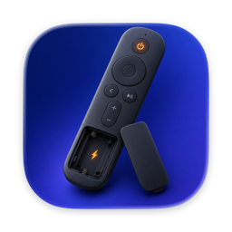
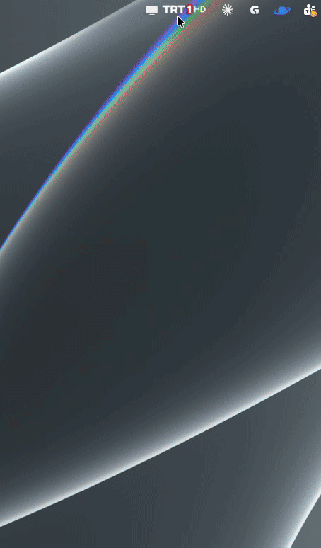
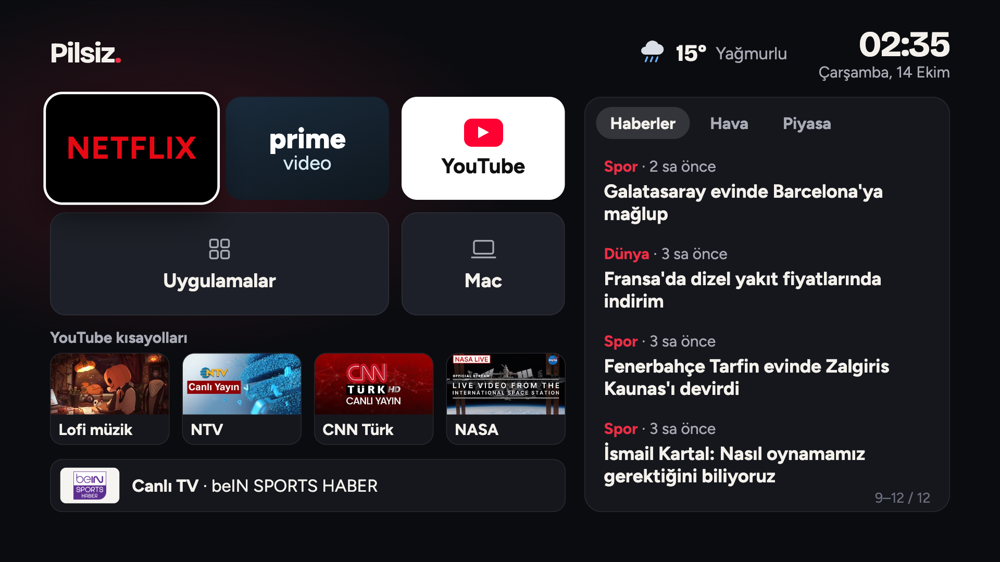
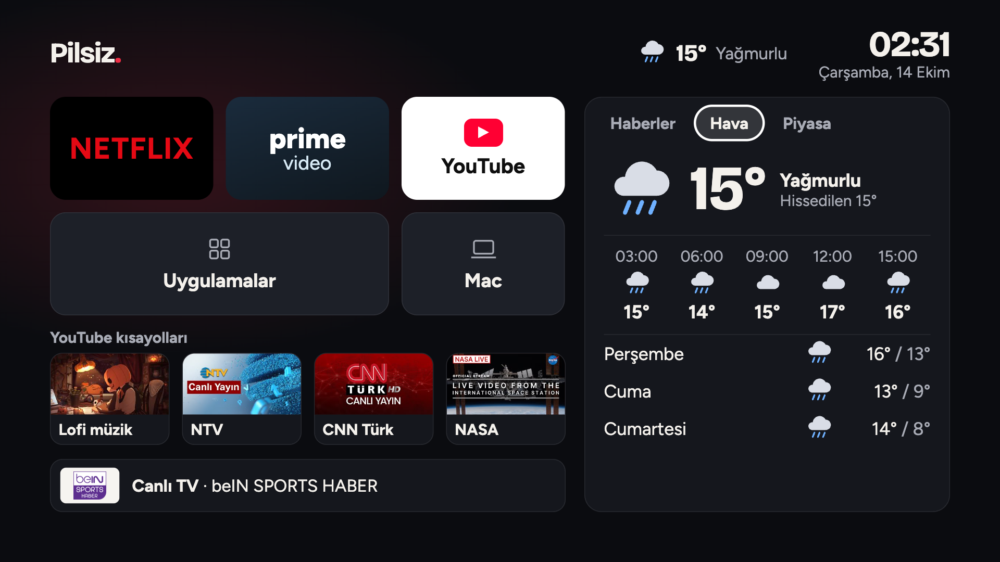
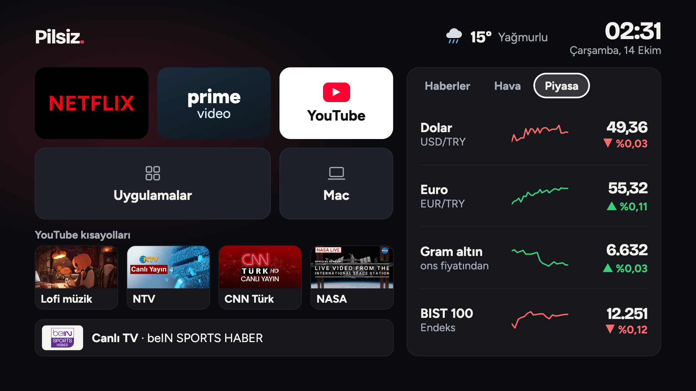
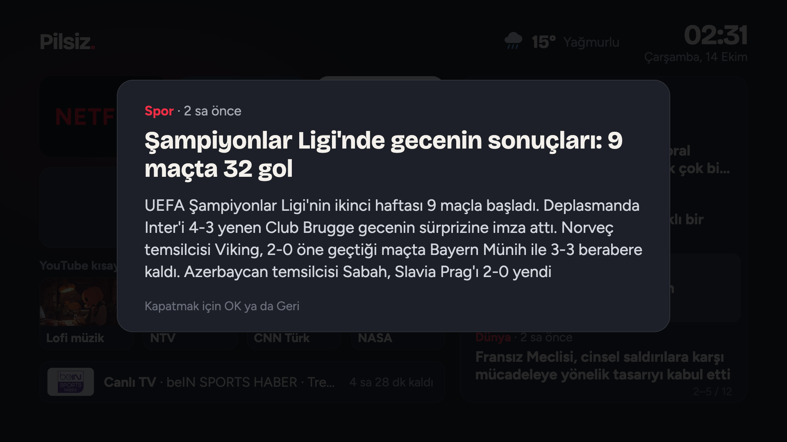
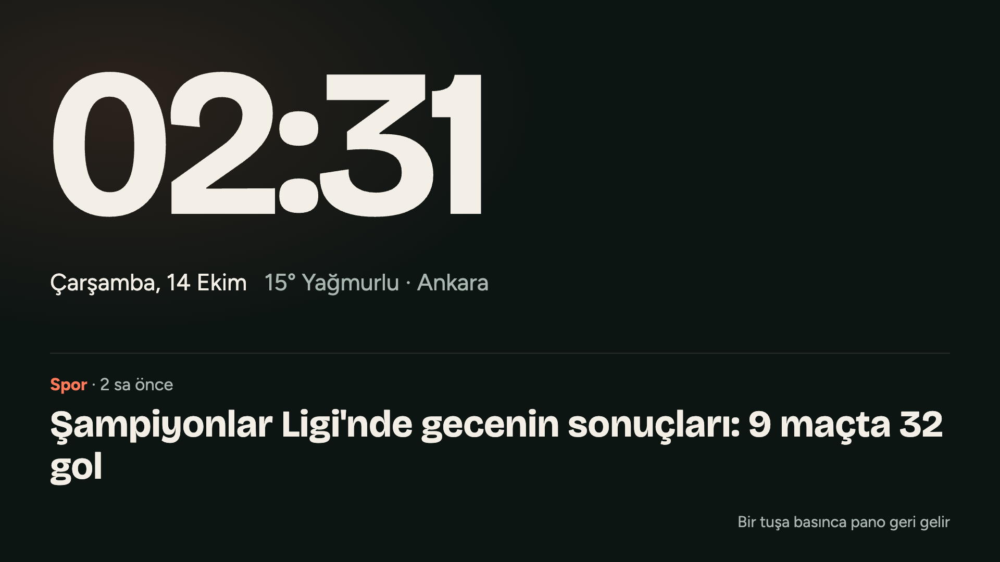
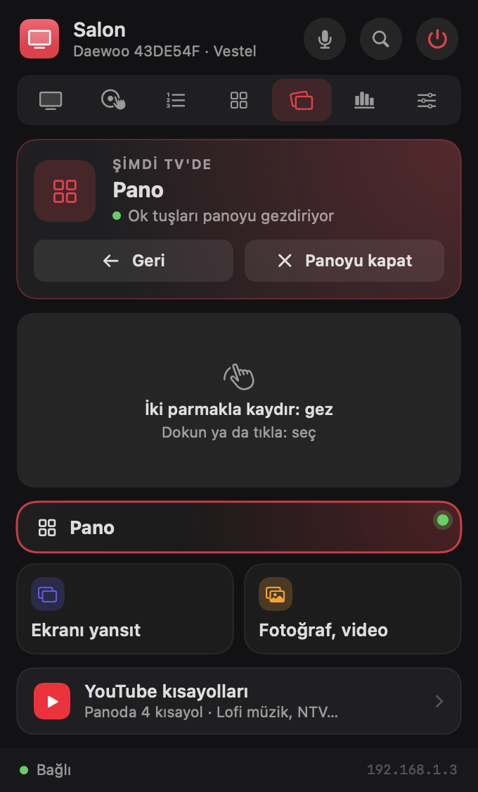

<div align="center">



# Pilsiz

**Vestel tabanlı akıllı TV'ni Mac'in menü çubuğundan yönet.**

Kumanda, kanal listesi, yayın akışı, sesli komut, ekran yansıtma ve TV'de açılan kişisel bir pano.<br>
Bulut yok, hesap yok: Mac ile TV yerel ağda doğrudan konuşur.


[Özellikler](#özellikler) · [Pano](#-pano) · [Pilsiz'e söyle](#-pilsize-söyle) · [Kurulum](#kurulum) · [Nasıl çalışır?](#nasıl-çalışır) · [Katkı](#katkı)

**Türkçe** · [English](README.en.md)

</div>

---

<div align="center">



<sub>Menü çubuğundan açılan panelde kısa bir tur</sub>

</div>

## Neden?

Fiziksel kumanda kırılınca TV'yi telefondaki *TV Smart Centre* uygulamasıyla yönetmek zorunda kalmıştım. Bu proje, aynı kontrolü Mac'e taşıyor. Hiçbir buluta bağlanmıyor; Mac ile TV, yerel ağ üzerinden doğrudan konuşuyor. Adı da buradan: pili hiç bitmeyen bir kumanda.

Vestel'in SmartCenter altyapısını kullanan TV'ler için yazıldı; ayrıntılar [Hangi TV'lerde çalışır?](#hangi-tvlerde-çalışır) bölümünde.

## Hangi TV'lerde çalışır?

Pilsiz, Vestel'in **SmartCenter** altyapısını kullanan akıllı TV'lerle konuşur. Bu altyapı Vestel'in ürettiği birçok markada var: Vestel, Regal, Toshiba, Hitachi, Telefunken, JVC, Finlux, Daewoo… Telefondaki *Smart Center* uygulaması TV'ni görebiliyorsa Pilsiz de büyük ihtimalle görür.

| | |
|---|---|
| ✅ **Her SmartCenter TV'de beklenen** | TV'yi ağda bulma, kumanda tuşları, ses, kanal listesini TV'den alma, Netflix / Prime Video / YouTube açma, YouTube linki oynatma, klavye ve imleç, Wake-on-LAN |
| 🔎 **Modele göre değişebilir** | TV'de göster ve Pano (TV'nin HbbTV tarayıcısı ve 12345 portu), giriş seçimi (kaynak menüsünün sırası), imlecin hangi ekranlarda göründüğü |
| 🇹🇷 **Türkiye'ye özel** | Yayın akışı (Türksat kanalları), kanal logoları, arayüzün ve sesli komutların dili. Başka bir ülkede kanal değiştirme çalışır; program bilgisi ve logolar boş kalır |

Pilsiz belirli bir TV varsaymaz: kanal listesi, model adı ve MAC adresi TV'nin kendisinden okunur. TV adı, giriş sırası, panonun şehri ve haber kaynağı Ayarlar'dan değişir.

Doğrulanan tek model **Daewoo 43DE54F** (anakart Vestel **17MB181TC**, yazılım 2.85.2.0). Başka bir modelde denersen model adını, neyin çalışıp neyin çalışmadığını bir [issue](https://github.com/thealibrs/pilsiz/issues) ile paylaşman çok işe yarar.

## 📺 Pano

Pano, TV'de tam ekran açılan kişisel bir ana ekran. *TV'de göster* sekmesindeki **Panoyu TV'de aç** düğmesiyle açılır; TV'ye uygulama kurmak gerekmez.



| | |
|---|---|
| **Uygulamalar** | Netflix, Prime Video ve YouTube doğrudan açılır. *Uygulamalar* kartı TV'nin kendi uygulama ekranını, *Mac* kartı ekran yansıtmayı başlatır |
| **YouTube kısayolları** | Dört kısayol, küçük resimleriyle. Video linki verirsen o video, kanal linki (`youtube.com/@kanal`) verirsen kanalın **o anki canlı yayını** açılır |
| **Haberler** | RSS akışından son 12 başlık. OK ile haberin özeti açılır |
| **Hava** | Şu anki durum, üçer saat arayla beş dilim ve üç günlük tahmin |
| **Piyasa** | Dolar, euro, gram altın ve BIST 100, gün içi grafikleriyle |
| **Canlı TV** | En son izlediğin kanal ve yayındaki program; seçince yayına dönersin |
| **Bekleme modu** | Üç dakika tuşa basılmazsa büyük saat ve sırayla değişen haber başlığı |

<table>
  <tr>
    <td align="center"><br><sub>Hava sekmesi</sub></td>
    <td align="center"><br><sub>Piyasa sekmesi</sub></td>
  </tr>
  <tr>
    <td align="center"><br><sub>Haber özeti</sub></td>
    <td align="center"><br><sub>Bekleme modu</sub></td>
  </tr>
</table>

**Panoyu gezmek.** Pano açıkken Pilsiz'in ok, OK ve geri tuşları TV'ye değil panoya gider. Üç yolu var:

- **Klavye:** ok tuşları, `Return` ve `Delete` (panel açıkken, hangi sekmede olursan ol).
- **Trackpad:** *TV'de göster* sekmesindeki dokunmatik alanda iki parmakla kaydır; odak parmaklarının gittiği yöne gider. İki parmakla dokunmak ya da tıklamak seçer.
- **Kumanda sekmesi:** ekrandaki yön tuşları.

Veriyi Mac toplar; TV'nin tarayıcısı internete çıkmaz. Kaynaklar: haber için seçilen RSS beslemesi (Gazete Oksijen, BBC Türkçe, CNN Türk, Habertürk, TRT Haber ya da istediğin bir RSS adresi), hava için [Open-Meteo](https://open-meteo.com), piyasa için Yahoo Finance. Şehir ve haber kaynağı *Ayarlar › Pano*'dan, YouTube kısayolları *TV'de göster* sekmesinden değişir.

## 🎙 Pilsiz'e söyle

Türkçe konuş ya da yaz; Pilsiz anlayıp TV'de yapar. **⌃⌥⌘ Space**'i basılı tutup konuş (kısa basarsan susunca biter), paneldeki 🎙 düğmesine bas ya da ⌘K'ya cümle yaz.

| Söylediğin | Pilsiz |
|---|---|
| "TRT biri aç", "kanal 15", "Show TV'yi aç" | Kanala geçer |
| "Sesi biraz kıs", "sesi 20 yap", "sessize al" | Sesi ayarlar |
| "Kızılcık Şerbeti ne zaman", "maç hangi kanalda" | Yayın akışından bulur, listeler |
| "Haberleri aç", "maçı aç", "Survivor'ı aç" | Yayındaysa o kanala geçer; değilse sıradaki yayına hatırlatıcı kurar |
| "Bu akşam ne var", "ne izlesem" | Akşamın programlarını, en çok izlediğin kanallara göre gösterir |
| "Televizyonu kapat" | TV'yi kapatır |

**Tamamen cihaz içinde:** konuşma, macOS'un Türkçe cihaz içi konuşma tanımasıyla yazıya dökülür; anlam, Apple'ın cihaz içi dil modeliyle (Foundation Models, macOS 26 + Apple Intelligence) çıkarılır. İnternet, hesap ya da API anahtarı gerekmez; ses Mac'ten çıkmaz. Sık komutlar (numara, ses, aç/kapat, "bu akşam") modele gitmeden kurallarla anında çözülür. Kanal ve program bilgisi her zaman uygulamanın kendi verisinden gelir; model yalnızca niyeti anlar, kanal ya da program uydurmaz. Apple Intelligence yoksa basit komutlar yine çalışır.

## Özellikler

| | |
|---|---|
| 🖥 **Ekranda** | TV'de o an ne açık: kanal logosu, **yayındaki program**, ilerlemesi ve sıradaki program; ya da Netflix/Prime Video/YouTube. Ses, favori kanallar, uygulamalar, girişler |
| 🎮 **Kumanda** | TV'nin kendi kumandasına benzeyen, kaydırmasız gövde: yön tuşları + OK, ana ekran, geri, menü, çıkış, medya tuşları, kanal ±, rakamlar, renkli tuşlar. Basılı tutunca tekrarlar |
| 📺 **TV'de göster** | [Pano](#-pano)yu aç, Mac ekranını TV'ye yansıt (tam HD, saniyede ~15 kare), fotoğrafları slayt olarak göster, video oynat. AirPlay olmadan, HbbTV ile |
| 📋 **Kanallar** | Liste ya da logo ızgarası. Listede o an yayındaki program, kalan süre ve ilerleme; ekrandaki kanal en üstte sabit. Favoriler, sık izlenenler, kanal/numara/program araması, düzenleme ve kanal tarama sihirbazı |
| 🔲 **Uygulamalar** | Netflix, Prime Video ve YouTube'u tek tıkla aç; bugünkü kullanım süreleri kartlarda. Açık uygulamayı tek tıkla kapatıp canlı yayına dön |
| 📊 **Aktivite** | TV'nin açık kaldığı süre, en çok izlenen kanallar, uygulama süreleri (bugün / 7 gün / 30 gün) |
| ⚙️ **Ayarlar** | TV menü kısayolları, IP/MAC, giriş sırası, oturum açılışında başlatma, ham tuş kodu deneme |

Ayrıca:

- 🔔 **Program hatırlatıcı:** Kanallar listesindeki takvim düğmesinden ya da "Sırada" satırındaki zilden bir programa hatırlatıcı kur. Başlamadan 5 dk önce gelen bildirimdeki **Kanala geç** düğmesi, TV kapalıysa önce açar, sonra o kanala geçer.
- ▶️ **YouTube linkini TV'de aç:** Linki Uygulamalar sekmesindeki karta yapıştır, panele sürükle-bırak ya da ⌘K'ya yapıştır; video (varsa zaman damgası ve oynatma listesiyle) TV'deki YouTube'da başlar. Panodaki link kendiliğinden önerilir.
- 📡 **Kanal listesi TV'den:** Kanallar sekmesindeki ⟳ düğmesiyle (ve günde bir kendiliğinden) TV'deki tüm kanallar (radyolar hariç) listeye eklenir; düzenlediğin adlar ve favoriler korunur.
- 🔎 **Hızlı arama (⌘K):** Kanal adı, numarası ya da **yayındaki program adıyla** ara ("kuruluş" yazınca dizinin olduğu kanal çıkar); ↑↓ ile seç, ↩ ile geç.
- 🧷 **Menü çubuğunda kanal:** Simgenin yanında o an açık kanalın logosu, istersen yayındaki programın adıyla birlikte görünür (Ayarlar'dan seçilir). Logosu olmayan kanallarda ve açık uygulamalarda ad yazar.
- ⌨️ **Her yerde çalışan kısayollar** (panel kapalıyken de; Ayarlar'dan kapatılabilir):

  | Kısayol | İşlev |
  |---|---|
  | `⌃⌥⌘ ↑` / `⌃⌥⌘ ↓` | Ses |
  | `⌃⌥⌘ →` / `⌃⌥⌘ ←` | Kanal + / − |
  | `⌃⌥⌘ M` | Sessiz |
  | `⌃⌥⌘ K` | Paneli kanal aramasıyla aç |
  | `⌃⌥⌘ Space` | Pilsiz'e söyle (basılı tut ve konuş) |

  ⌃⌥⌘ seçildi çünkü ⌥⌘←/→ tarayıcılarda sekme değiştirir.

- 🔍 **Otomatik keşif:** TV'yi yerel ağda kendisi bulur, MAC adresini öğrenir.
- 🔊 **Sürüklenebilir ses çubuğu:** TV ses seviyesini ağdan bildirmediği için seviye uygulamada takip edilir. Çubuk, aradaki fark kadar +/− basışı gönderir.
- ⚡ **Wake-on-LAN:** TV kapalıyken güç tuşu ağdan uyandırma paketi gönderir. Kapalıyken bir kanala ya da uygulamaya basarsan TV önce uyanır, sonra o kanal ya da uygulama açılır.
- ⌨️ **Panel kısayolları** (Ekranda ve Kumanda sekmelerinde; pano açıkken yön, OK ve geri her sekmede çalışır):

  | Tuş | İşlev | Tuş | İşlev |
  |---|---|---|---|
  | ← ↑ → ↓ | Yön | `Return` | OK |
  | `Delete` | Geri | `Space` | Oynat |
  | `+` / `-` | Ses | `m` | Sessiz |
  | `]` / `[` | Kanal ± | `0`–`9` | Rakam |
  | `h` | Ana ekran | `s` | Kaynak |
  | `i` | Bilgi | `e` | Çıkış |

## Ekran görüntüleri

<table>
  <tr>
    <td align="center" valign="top"><br><sub>Ekranda</sub></td>
    <td align="center" valign="top"><br><sub>Kumanda</sub></td>
    <td align="center" valign="top"><br><sub>Kanallar</sub></td>
  </tr>
  <tr>
    <td align="center" valign="top"><br><sub>TV'de göster (pano açık)</sub></td>
    <td align="center" valign="top"><br><sub>Uygulamalar</sub></td>
    <td align="center" valign="top"><br><sub>Aktivite</sub></td>
  </tr>
</table>

## Kurulum

**Gereksinimler:** Çalıştırmak için macOS 14 veya üstü ("Pilsiz'e söyle"nin dil modeli için macOS 26 ve Apple Intelligence). Derlemek için Xcode 26 (macOS 26 SDK, Swift 6). Harici bağımlılık yok.

```bash
git clone https://github.com/thealibrs/pilsiz.git
cd pilsiz
./build.sh
```

`build.sh` şunları yapar:

1. `swift build -c release` ile derler.
2. `.app` paketini geçici bir klasörde oluşturur, logoları ve pano fontlarını ekler, uygulama simgesini `actool` ile derler.
3. Anahtar zincirindeki ilk **Apple Development** sertifikasıyla imzalar (yoksa ad-hoc imzalar).
4. `/Applications/Pilsiz.app` olarak kurar ve başlatır.

> **Neden sabit sertifika?** macOS, *Yerel Ağ* iznini uygulamanın imzasına bağlar. Ad-hoc imza her derlemede değiştiği için izin her seferinde sıfırlanır. Farklı bir sertifika kullanmak için: `SIGN_IDENTITY="..." ./build.sh`

### İlk açılış

1. macOS **"yerel ağdaki aygıtları bulma"** izni ister → **İzin Ver**. (Sonradan: *Sistem Ayarları › Gizlilik ve Güvenlik › Yerel Ağ*)
2. Uygulama TV'yi ağda arar ve bulur. Bulamazsa *Ayarlar › Bağlantı*'dan IP adresini elle gir.
3. TV açıksa kanal listesi TV'den kendiliğinden alınır. Sonradan almak için: *Kanallar › … › Kanal listesini TV'den eşitle*.
4. TV kapalıyken de açabilmek için TV'de **Ayarlar › Ağ › Ağ Tabanlı Bekleme Modu** seçeneğini aç (bazı modellerde adı *Ağda Uyandırma* ya da *Wake On LAN*).

Özelliğe göre istenen öbür izinler: ekran yansıtma için *Ekran ve Sistem Sesi Kaydı*, "Pilsiz'e söyle" için *Mikrofon* ve *Konuşma Tanıma*, hatırlatıcılar için *Bildirimler*.

### Gizlilik

Pilsiz'in kendi sunucusu, hesabı ya da telemetrisi yok. Mac'ten dışarı yalnızca şunlar için istek çıkar: yayın akışı dosyaları, YouTube'a video gönderme ve (pano açıkken) haber, hava, piyasa ve YouTube küçük resimleri. Sesli komutlar cihaz içinde işlenir. Kanal listesi, favoriler ve izleme istatistikleri Mac'te `UserDefaults` içinde kalır.

Mac'teki küçük sunucu (port 8765) ilk gönderimde ya da pano açılınca başlar, TV'deki ekran kapatılınca durur. Çalışırken yerel ağdaki her cihazdan erişilebilir; kimlik doğrulaması yoktur. Güvenmediğin ağlarda ekran yansıtmayı ve panoyu kullanma.

## Nasıl çalışır?

Vestel TV'ler, SmartCenter mobil uygulaması için **56789** portunda bir DIAL sunucusu çalıştırır. Uygulama bu sunucuyla düz HTTP üzerinden konuşur.

```
┌──────────────────┐        HTTP (yerel ağ)        ┌────────────────────────┐
│  Pilsiz          │  POST /apps/SmartCenter  ───▶ │  Vestel TV  :56789     │
│  (menü çubuğu)   │  POST /apps/Netflix      ───▶ │  DIAL + sanal kumanda  │
│                  │  GET  /apps/<uygulama>   ───▶ │                        │
│                  │  UDP :9  Wake-on-LAN     ───▶ │  (bekleme modunda)     │
└──────────────────┘                               └────────────────────────┘
```

### Tuş gönderme

```http
POST /apps/SmartCenter HTTP/1.1
Content-Type: application/xml
Connection: close

<remote><key code=1016 /></remote>
```

> ⚠️ `code` değeri **tırnaksız** gönderilmeli. Ayrıca TV'nin gömülü sunucusu bağlantı tekrar kullanımında takılabildiği için her istek kendi TCP bağlantısını açar ve komutlar sırayla gönderilir.

<details>
<summary><b>Tuş kodları</b></summary>

| Tuş | Kod | Tuş | Kod | Tuş | Kod |
|---|---|---|---|---|---|
| 0–9 | 1000–1009 | Güç | 1012 | Sessiz | 1013 |
| Geri | 1010 | Ses + | 1016 | Ses − | 1017 |
| Bilgi | 1018 | Aşağı | 1019 | Yukarı | 1020 |
| Sol | 1021 | Sağ | 1022 | OK | 1053 |
| Durdur | 1024 | Oynat | 1025 | Duraklat | 1049 |
| Geri sar | 1027 | İleri sar | 1028 | Altyazı | 1031 |
| Kanal + | 1032 | Kanal − | 1033 | Önceki kanal | 1034 |
| Çıkış | 1037 | Kanal listesi | 1045 | Ana ekran | 1046 |
| Rehber (EPG) | 1047 | Menü | 1048 | Kaynak | 1056 |
| Kırmızı | 1055 | Yeşil | 1054 | Sarı | 1050 |
| Mavi | 1052 | Medya | 1057 | İnternet | 1065 |
| Ayarlar | 1067 | Hızlı menü | 1043 | Görüntü oranı | 1011 |

</details>

### TV'de göster (HbbTV)

TV'nin Vewd DIAL sunucusu (port **12345**) bir `HbbTV` uygulaması yayımlıyor (HbbTV 2.0 "companion screen"). Buraya bir uygulama tanımı (XML AIT) gönderilince TV, verilen adresteki web sayfasını tam ekran bir HbbTV uygulaması olarak açar:

```http
POST http://<tv>:12345/apps/HbbTV
Content-Type: text/plain; charset=utf-8

<mhp:ServiceDiscovery …><mhp:URLBase>http://<mac>:8765/</mhp:URLBase>…<mhp:applicationLocation>index.html</mhp:applicationLocation>…
```

- TV her açılışta bir **Evet/Hayır** onayı sorar ("Evet" seçili gelir) ve sayfayı ancak onaydan sonra indirir. Pilsiz 1,5 sn sonra OK gönderir, sayfa inmediyse 4,5 ve 8 sn'de yeniden dener. Sayfa açık kaldıkça yeni gönderimlerde tekrar sorulmaz.
- Pilsiz Mac'te küçük bir sunucu (port **8765**) çalıştırır; TV'deki sayfa yarım saniyede bir `/state` sorar, kareleri tek bir kalıcı MJPEG bağlantısından (`/stream.mjpg`), videoyu `/video.mp4`'ten (Range destekli) alır.
- Tarayıcı Chrome 108 tabanlı Opera (Vewd OMI); sayfayı **katı XHTML** olarak okur: betikler `CDATA` içinde olmalı, yoksa sessizce çalışmaz.
- Videoyu JavaScript ile eklemek ya da `play()` ile başlatmak TV'nin uygulamayı kapatmasına yol açar; video, `<video autoplay>` etiketinin doğrudan yazıldığı ayrı bir sayfada oynatılır.
- TV'nin video çözücüsü 1920×1080 ile sınırlı: iPhone'un dikey videoları (720p ayarıyla 1280 px yükseklik) oynamaz; Pilsiz dikey videoları 540×960, yatayları 1280×720 H.264 MP4'e dönüştürür.
- Ekran yansıtma ScreenCaptureKit'in sürekli yakalamasıyla (SCStream) 1920 piksel genişliğinde JPEG kareler gönderir; Pilsiz'in kendi paneli hariç tutulur. TV'nin tarayıcısı MJPEG akışını saniyede en fazla ~15 kez güncellediği için kare hızı 15'te tutulur. Sunum ve web sayfaları için uygundur, film izlemek için değil.

### Pano: sayfa, gezinme ve veri

Pano, "TV'de göster" ile aynı HbbTV ekranında açılan 1280×720'lik tek bir XHTML sayfasıdır ([`DashboardPage.swift`](Sources/Pilsiz/DashboardPage.swift)).

```
        Pilsiz (Mac)                                         TV (HbbTV sayfası)
  ┌───────────────────────┐   GET /pano.json, /pano/img/…   ┌──────────────────┐
  │ Dashboard             │ ◀────────────────────────────── │ veri ve görseller│
  │  haber · hava · piyasa│   GET /pano/poll  (açık bekler) │                  │
  │  kısayollar           │ ◀────────────────────────────── │ tuş bekleniyor   │
  │                       │ ──── {"keys":["right"]} ──────▶ │ odak sağa kayar  │
  │ ok tuşu / trackpad    │   GET /pano/act?id=app:netflix  │                  │
  │ TV'de Netflix'i açar  │ ◀────────────────────────────── │ OK'e basıldı     │
  └───────────────────────┘                                 └──────────────────┘
```

- **Tuşlar TV'den değil Mac'ten gelir.** Ağdan gönderilen kumanda tuşları HbbTV sayfasına ulaşmıyor. Bu yüzden sayfa `/pano/poll` isteğini açık tutar (uzun yoklama); Pilsiz'de bir yön tuşuna basılınca istek hemen yanıtlanır ve odak sayfada kayar. Gezinme mantığı sayfadadır: verilen yöndeki en yakın kart.
- **Seçim Mac'e bildirilir.** OK'e basılınca sayfa `/pano/act?id=…` çağırır. Mac önce panoyu kapatır (TV yayına döner), ardından uygulamayı DIAL ile açar ya da videoyu YouTube Lounge ile gönderir.
- **TV dışarıya istek atmaz.** Haber, hava, piyasa ve YouTube küçük resimlerini Mac toplar; fontlar da (`Resources/Fonts`) Mac'ten sunulur.
- **Canlı yayın kısayolları.** Kanal linki, kanalın `/live` sayfasındaki `canonical` adresinden o anki videoya çözülür ve yarım saatte bir yenilenir.
- **Gram altın**, ons fiyatı ile dolar kurundan hesaplanır; Kapalıçarşı fiyatından biraz farklı olabilir.
- **Geliştirme.** `PILSIZ_PANO=1 PILSIZ_PORT=8791 swift run` panoyu TV'ye dokunmadan sunar; `http://localhost:8791/` tarayıcıda açılır ve klavyenin ok tuşlarıyla gezilir. Sayfa TV'de katı XHTML olarak okunduğu için aynı katılık yerelde de uygulanır: bozuk bir etiket tarayıcıda hemen hata verir.

### Komutlar, klavye ve imleç

Aşağıdakiler, telefondaki *TV Smart Centre* uygulamasının trafiği mitmproxy ile kaydedilip [REA](https://github.com/morluto/rea) ile çözümlenerek bulundu. Hepsi aynı uç noktaya gider; komutlarda telefon uygulaması gibi `application_name: tv smart centre` başlığı gönderilir.

| Amaç | İstek gövdesi |
|---|---|
| Kanal listesi | `<?xml version='1.0'?><command>activechannellist</command>` |
| TV özellikleri | `<?xml version='1.0'?><command>specialportalapps</command>` |
| Metin (harf başına) | `<?xml version='1.0' ?><keyboard><key value='116'/></keyboard>` (ASCII/Unicode kodu) |
| İmleç (~60 Hz) | `<?xml version='1.0'?><mouseevent><event_data dx='8.0' dy='-29.3' button='0'/></mouseevent>` |

Komutların HTTP yanıtı boştur; **sonuç, TV'nin 7681 portundaki WebSocket'ine yayınlanır**. Kanal listesi şöyle gelir (TV adlarda `&` karakterini kaçırmadığı için esnek ayrıştırılır):

```xml
<active_list network='None' count='614' total_size='67979'>
  <service rsn='1' name='TRT 1 HD' handle='715' onid='0' tsid='7' sid='10601' type='25' is_encrypted='0'/>
  …
```

`rsn` TV'deki kanal numarası, `type` 25/22/1 yayın, 2 radyo, 131 internet kanalıdır. TV listeyi yalnızca o an bağlı istemcilere gönderdiği için WebSocket, komuttan **önce** açılmalıdır.

### YouTube'a video gönderme

DIAL'a `v=<id>` göndermek YouTube'u açar ama videoyu oynatmaz. Bunun yerine telefonlardaki "TV'de izle" düğmesinin kullandığı **YouTube Lounge** kanalı kullanılır:

1. **Eşleştirme (bir kez):** `POST /apps/YouTube` gövdesi `pairingCode=<uuid>&theme=cl` → TV'deki YouTube bu kodla kaydolur; `POST https://www.youtube.com/api/lounge/pairing/get_screen` (`pairing_code=<uuid>`) kalıcı `screenId` döndürür. TV'de kod girmek gerekmez.
2. **Anahtar:** `POST …/pairing/get_lounge_token_batch` (`screen_ids=<screenId>`) → `loungeToken`.
3. **Oturum:** `POST …/bc/bind?…&loungeIdToken=…` gövdesi `count=0` → yanıttan `SID`, `gsessionid`, `AID`.
4. **Oynat:** aynı uca `req0__sc=setPlaylist&req0_videoId=<id>&req0_currentTime=<sn>…`.

Lounge API'si belgelenmemiştir; açık kaynak istemcilerle (ör. pyytlounge) aynı biçimde kullanılır.

### Uygulamalar (DIAL)

| Uygulama | Uç nokta | Not |
|---|---|---|
| Netflix | `POST /apps/Netflix` | Ek başlık gerekmez |
| Prime Video | `POST /apps/AmazonInstantVideo` | Ek başlık gerekmez |
| YouTube | `POST /apps/YouTube` | `Origin: https://www.youtube.com` olmadan **403** döner |

Açık olan uygulama, `GET /apps/<ad>` yanıtındaki `<state>running</state>` ile izlenir.

### Yayın akışı

Programlar iki açık XMLTV kaynağından birleştirilir: **[epgshare01](https://epgshare01.online/epgshare01/)** (178 kanal, 3 gün; gzip, macOS'un yerleşik DEFLATE çözücüsüyle açılır) ve onda olmayan kanallar için **[iptv-epg-turkey](https://github.com/trology85/iptv-epg-turkey)** (yalnızca o gün). İkisi aynı yayın verisini veriyor; üçüncü bir kaynağın (iptv-epg.org) saatleri tutmadığı için kullanılmadı. Akış 6 saatte bir ve gün değişince yenilenir, `~/Library/Application Support/Pilsiz/` altında önbelleğe alınır. Kanallar adlarıyla eşleştirilir (`"STAR TV HD"` ↔ `"Star"`, `"HABERTÜRK HD"` ↔ `"HABERTÜRK TV"`).

### Kanal geçişi

TV kanal adlarını ağ üzerinden vermez. Bu yüzden kanal listesi Mac'te tutulur; bir kanala tıklamak, numarasını rakam rakam tuşlar. Logolar, kanal adından türetilen anahtarla eşleşir: `"TRT 1 HD"` → `trt1.png`, `"HABERTÜRK HD"` → `haberturk.png`.

## Proje yapısı

```
Sources/Pilsiz/
├── PilsizApp.swift      # Menü çubuğu simgesi + oklu NSPopover
├── TVController.swift   # Durum, komut kuyruğu, ses takibi, keşif, Wake-on-LAN
├── Network.swift        # Minimal HTTP istemcisi (Network.framework), SmartCenter/DIAL, WoL
├── Stores.swift         # Kanal listesi ve aktivite verisi (UserDefaults)
├── RemoteKey.swift      # Tuş kodları
├── RootView.swift       # Başlık, sekme çubuğu, klavye kısayolları
├── Tabs.swift           # Ekranda, Aktivite
├── AppsTab.swift        # Uygulamalar sekmesi
├── ChannelsTab.swift    # Kanal listesi ve ızgarası, düzenleyici, tarama sihirbazı
├── SettingsTab.swift    # Ayarlar
├── ChannelLogo.swift    # Logo eşleştirme ve yedek rozet
├── EPG.swift            # Yayın akışı: indirme, önbellek, XMLTV ayrıştırma, ad eşleştirme
├── Reminders.swift      # Program hatırlatıcıları ve bildirimler
├── CommandPalette.swift # ⌘K hızlı arama
├── HotKeys.swift        # Sistem geneli kısayollar (Carbon)
├── YouTube.swift        # YouTube linki ayrıştırma ve Lounge ile TV'de oynatma
├── Assistant.swift      # Pilsiz'e söyle: kurallar + cihaz içi model, eylemler
├── Voice.swift          # Türkçe cihaz içi konuşma tanıma ve ekranın üstündeki kapsül
├── ShareServer.swift    # TV'deki HbbTV sayfası ve onun bağlandığı yerel sunucu (Range destekli)
├── ScreenShare.swift    # Ekran yakalama, fotoğraf slaytı, video dönüştürme, onay
├── Dashboard.swift      # Pano: haber, hava, piyasa ve kısayol verisi, seçilen kartın işlenmesi
├── DashboardPage.swift  # Panonun TV'de açılan sayfası
├── PanoTouchpad.swift   # Panoyu trackpad kaydırmalarıyla gezdiren alan
├── ShareTab.swift       # TV'de göster sekmesi
├── Remote.swift         # Kumanda sekmesi
├── Components.swift     # Tema ve ortak bileşenler
└── Snapshot.swift       # (yalnızca DEBUG) sekmeleri PNG'ye çizer
Resources/
├── Info.plist
├── tv.png               # "Ekranda" sekmesindeki gerçekçi TV görseli
├── Fonts/               # Pano fontları (Figtree, Bricolage Grotesque; SIL OFL)
└── Logos/               # Kanal logoları
```

Debug derlemesinde README'deki panel görüntülerini yeniden üretmek için (TV kapalıyken de çalışır; panel "bağlı" durumda çizilir):

```bash
swift build && PILSIZ_SNAPSHOT=/tmp/snap .build/debug/Pilsiz
```

Pano görüntüleri, yerel pano sunucusu (`PILSIZ_PANO=1`) açıkken tarayıcıdan 1280×720 pencereyle alınır.

## Bilinen sınırlamalar ve yol haritası

- [x] Kanal listesini TV'den **otomatik çekmek**
- [x] Klavye ile metin girişi, touchpad/imleç (protokol çözüldü; arayüzde şu an yok)
- [x] Mac ekranını, fotoğrafları ve videoları TV'de göstermek (HbbTV)
- [x] TV'de açılan pano; klavye ve trackpad ile gezinme
- [ ] Pano şehrini ve haber kaynağını ayarlardan seçmek (şu an kodda sabit)
- [ ] Başka Vestel tabanlı modellerde doğrulama (yalnızca Daewoo 43DE54F'de denendi)
- [ ] Netflix, Prime Video ve YouTube dışındaki uygulamaları doğrudan açmak: bu TV'nin DIAL servisi başka uygulama tanımıyor, öbürlerine yalnızca TV'nin uygulama ekranından ulaşılıyor
- [ ] Ses seviyesini TV'den **okumak**: telefon uygulaması da yalnızca +/− gönderiyor; protokolde okuma bulunmadı
- [ ] Şu anki kanalı TV'den okumak (telefondan değiştirilen kanalı bilmek)
- [ ] Parlaklık, kontrast gibi görüntü ayarları
- [ ] Girişleri doğrudan seçmek (şu an kaynak menüsü açılıp sıra numarası gönderiliyor)

Kalanlar için sıradaki adım: SmartCenter'ın Android APK'sını REA ile statik olarak incelemek.

## Katkı

Hata bildirimi, başka TV modellerinden deneme sonuçları ve değişiklik önerileri memnuniyetle karşılanır.

- **Başka bir TV'de denediysen** modeli, anakart kodunu (varsa) ve neyin çalışıp neyin çalışmadığını bir [issue](https://github.com/thealibrs/pilsiz/issues) ile yaz. En değerli katkı bu.
- **Kod değişikliği için** depoyu çatalla, `swift build` ile derlendiğinden emin ol ve bir pull request aç. Harici bağımlılık eklememeye çalış; proje bilerek bağımlılıksız.
- Koddaki yorumlar ve arayüz Türkçe; katkılarda da öyle kalması tercih edilir.

## Teşekkürler ve kaynaklar

- [ha-vestel-toshiba-tv](https://github.com/mutlutekir/ha-vestel-toshiba-tv): `/apps/SmartCenter` uç noktası ve tırnaksız kod biçimi
- [pyvesteltv](https://github.com/T3m3z/pyvesteltv) ve [ha-vestel-component](https://github.com/andylynch/ha-vestel-component)
- [node-red-contrib-vestel-tv](https://github.com/hyttysmyrkky/node-red-contrib-vestel-tv): genişletilmiş tuş haritası
- [shkspr.mobi](https://shkspr.mobi/blog/2018/11/telnet-control-of-toshiba-smart-tvs/): Toshiba/Vestel tuş kodları
- Yayın akışı: [epgshare01](https://epgshare01.online/epgshare01/) ve [trology85/iptv-epg-turkey](https://github.com/trology85/iptv-epg-turkey)
- Pano verisi: seçilen haber sitesinin RSS'i (varsayılan [Gazete Oksijen](https://gazeteoksijen.com)), [Open-Meteo](https://open-meteo.com) (hava ve şehir arama), Yahoo Finance (piyasa)
- Pano fontları: [Figtree](https://github.com/erikdkennedy/figtree) ve [Bricolage Grotesque](https://github.com/ateliertriay/bricolage), SIL Open Font License 1.1 ile (lisans metinleri `Resources/Fonts` içinde)
- Kanal logoları: [tv-logo/tv-logos](https://github.com/tv-logo/tv-logos)
- "Ekranda" sekmesindeki TV görseli Higgsfield (GPT Image 2.5) ile üretildi
- Arayüz fikri: [@greco_dev](https://x.com/greco_dev/status/2109842197654692349)'in LG webOS menü çubuğu uygulaması

## Lisans

Kod [MIT lisansı](LICENSE) ile yayımlanır. Fontlar kendi lisanslarıyla (SIL OFL 1.1) dağıtılır.

Kanal logoları ile Netflix, Prime Video, YouTube ve diğer marka adları ilgili sahiplerinin tescilli markalarıdır; burada yalnızca kanalı ya da uygulamayı tanıtmak için kullanılır ve MIT lisansının kapsamında değildir. Hak sahibi talep ederse kaldırılır.

Bu proje Vestel, Daewoo, Google, Netflix, Amazon, Yahoo ya da adı geçen herhangi bir yayıncıyla bağlantılı değildir ve onlar tarafından desteklenmez. YouTube Lounge, Yahoo Finance ve SmartCenter uç noktaları belgelenmemiş arayüzlerdir; haber vermeden değişebilir ya da kapanabilir.
